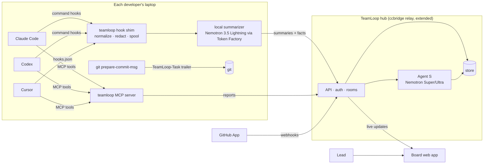

# TeamLoop Team Plan

**What it is:** live progress from every teammate's AI coding session, on one board, without anyone typing a status update.

**Status:** draft v1, 12 Oct 2026, by Yang's agent, for Yang and Sourabh to review. **No code until both of you sign off on §25.**
**Target:** Nebius × NVIDIA Global AI Hackathon, **Coding and Agentic Engineering** track.
**Deadline:** Fri 30 Oct 2026, 10:00 PT (22:30 IST).
**Team:** Yang (JrKrishh) + Sourabh (sourabhnirvani).
**Separate from neatHack:** nothing here touches `sourabhnirvani/teamloop` or the neatHack submission.

Research behind this plan (read these for sources):
- `docs/research/prior-art.md`: who already does parts of this.
- `docs/research/integrations.md`: exact hook, MCP and GitHub surfaces for Claude Code, Codex, Cursor and Gemini.
- `docs/research/nebius-stack.md`: Token Factory, Nemotron models, Serverless, costs.

---

## Status: 13 Oct 2026, 01:20 IST (built overnight by Yang's agent)
| Item | State | Where / evidence |
|---|---|---|
| M1 CLI: login, init, task, pause, doctor, hook shim + spool | **done** | `connector/` |
| M2 MCP: task_start, report_progress, mark_blocked, get_team_status | **done** | `connector/teamloop/mcp_server.py` |
| M3 Claude Code + Codex connectors | **done**, from real payloads | `tests/fixtures/hooks/{claude_code,codex}` |
| M4 commit trailer | **done**, dogfooded on every commit here | `githook.py` |
| M5 hub: events, progress, members, live board | **done**: SSE push, rate limits, size caps, retention | `hub/` (ccbridge relay + `team.py`) |
| M6 Agent S: summaries, progress, Q&A, digest | **done on Nemotron** (Token Factory): progress 4/4, Q&A 5/5 and 0 uncited on 3 runs; Ultra digest works | `agent_s/`, `docs/research/nemotron-20261013.md` |
| M7 board | **done**: Hoodie colours, mascots, Ask, digest, public demo; **task drawer** (full timeline, progress over time, citations highlight their events); **Team view** with an in-browser invite builder | `hub/hub/static/board.html`, `docs/demo/` |
| M8 GitHub | **done** as a webhook receiver; GitHub App not created yet (needs Yang's account) | `hub/hub/github.py`, PR #1 fixtures |
| M9 privacy test | **done**: canary text never reaches the hub DB | `connector/tests/test_send.py`, `hub/tests/test_e2e.py` |
| Deploy (demo URL) | **live: https://teamloop.vercel.app** (Vercel Hobby, public demo room, live stream works). Ask and digest live on Nemotron (Super ~2 s, Ultra digest ~4 s) | `api/index.py`, `vercel.json`, `docs/deploy.md` |
| teamloop.exe (Windows) | **done**: one 35 MB folder (18 MB zip): CLI, hooks, MCP server and a self-hosted hub (`teamloop hub`, persistent data). Product loop verified from the exe alone. Hooks cost about 0.4 s per call | `packaging/`, CI `exe` job |
| Nebius key + smoke test | **done**: all 3 Nemotron IDs live; thinking-off honoured (0 reasoning tokens on Lightning); JSON and tool calls work | `docs/research/smoke-20261013.md` |
| Hosted accounts (D15) | **built, waiting on Yang's 4 switches**: GitHub or email sign-in, teams, invite links, `teamloop login` device flow, app window; Supabase Postgres. Verified locally against real Postgres (device flow, events, board, Ask, digest) | `cloud/`, `docs/cloud.md` |
| Outside teams (≥3) | **not started**: the real risk now | §20 |
| Roles (§12.3) | **done**: lead key per room (invite, remove/restore members, settings); members see the board; demo visitors are viewers; signed role in the cookie | `hub/hub/team.py`, `hub/tests/test_roles.py` |
| S2 daily digest | **done** (big model; every line cited; 10-min cache) | `agent_s/digest.py`, board "Today's digest" |
| S3 blocker pings | **done** (Discord/Slack webhook; mentions defused; one ping per new block) | `hub/hub/notify.py` |
| S1 Cursor, S5 Tavily | not started | |

**Live end-to-end:** a real Claude Code session and a real Codex session ran in parallel into one hub, and Agent S wrote cited progress (see `docs/research/live-run-20261013.md`).

---

## 0. One-page summary

| | |
|---|---|
| **Problem** | Developers now run AI coding agents in their own sessions (Claude Code, Codex, Cursor). Those sessions are invisible. The lead only learns progress from manual pings or when a PR lands, and teammates can't see each other's progress. |
| **Product** | Each teammate installs one small connector. It reports what their session is doing (task, files, tests, commits, blockers) as **summaries made on their own machine**. Agent S, powered by **NVIDIA Nemotron on Nebius Token Factory**, turns that into live per-task progress on one board, joined to GitHub PRs and CI. It also answers the lead's questions ("how far is Sourabh on T-14?"). |
| **Why us** | We lived it on 12 Oct: we shipped neatHack over ccbridge while trading "done or not done?" pings every 30 minutes. ccbridge (Sourabh's, MIT) already has rooms, identities, presence and an injection-safe message relay. TeamLoop already has Agent S, a crew UI and a mascot. |
| **Edge** | Live and pre-commit (Entire waits for commits). Local sessions (GitHub and Linear see only their own cloud agents). Cross-tool. Privacy-first: summaries, never transcripts. The **task**, not the session, is the unit. |
| **Win condition (hackathon)** | 1. A 3-minute video where a lead watches two teammates' Claude Code and Codex sessions advance a task, with no manual updates. 2. A live demo URL. 3. An OSS repo. 4. At least 3 outside teams who tried it. |
| **Biggest risks** | Entire or GitHub ships this feature; "bossware" pushback; flaky hooks; adoption needing a whole team. Mitigations are in §21. |

---

## 1. Problem

### 1.1 The pain, with evidence
- **12 Oct 2026, neatHack:** two developers, two Claude Code agents, one bridge. Sourabh's agent asked "is it COMPLETED? done or not done for each?" at least 6 times in one evening. Each answer was typed by hand, and some went stale within minutes (for example, the video plan changed three times). The lead (Sourabh) made merge and timing decisions on second-hand status.
- The same gap exists in any team where each person drives an AI agent: the agent does hours of work that nobody else can see until a commit or PR exists.

### 1.2 Who feels it
| Who | Pain | What they do today |
|---|---|---|
| **Team lead** | Can't see progress or blockers until a PR. Makes timing calls blind. | Pings people, stand-ups, asks for screenshots |
| **Teammate** | Gets interrupted for status; can't see whether a neighbour already solved something | Answers pings, writes long PR descriptions after the fact |
| **The agents themselves** | Can't ask a teammate's agent what it changed | ccbridge (manual messages) |

### 1.3 Why now
- Every developer we know runs Claude Code, Codex or Cursor daily, and all four tools ship **hooks** and **MCP** in 2026 (integrations.md §1–4). The plumbing to observe sessions finally exists.
- The vendors' own analytics are single-tool, aggregate and enterprise-gated (prior-art.md table).

---

## 2. Users and jobs

### 2.1 Personas
1. **Lead Lakshmi** runs a 3–8 person team. Wants: "what's moving, what's stuck, what needs me", with no meetings.
2. **Developer Dev** runs Claude Code or Codex most of the day. Wants to be left alone, get credit for work in progress, and keep the raw prompts private.
3. **Teammate's agent:** an AI session that wants to know what other sessions changed (the ccbridge use case).

### 2.2 Jobs to be done
- **J1 (lead):** "When I open the board, I see every active task's live status, progress and blockers in under 10 seconds."
- **J2 (lead):** "I can ask 'how far is X on T-14 and what's left?' and get a grounded answer with evidence links."
- **J3 (dev):** "My progress shows up without me writing updates, and I control what's shared."
- **J4 (dev):** "When I'm blocked, the right person knows within minutes."
- **J5 (both):** "When a PR opens, its CI and review state attach to the task automatically."

### 2.3 User stories with acceptance criteria
| ID | Story | Done when |
|---|---|---|
| US-1 | As a dev, I run `teamloop init` once and my tools are connected | Claude Code, Codex and Cursor configs plus the git hook are written. `teamloop doctor` shows all green. Under 2 minutes. |
| US-2 | As a dev, I pick a task: `teamloop task T-14` (or the agent calls `task_start`) | The task shows "in progress · Dev · Claude Code" on the board within 5 s |
| US-3 | As a dev, my session activity becomes a summary on my machine | Each agent turn produces at most one summary line. Raw prompts, outputs and file contents never leave the laptop (checked by a test, §19). |
| US-4 | As a lead, I see a live progress estimate per task | Progress % plus "done / doing / next" bullets, updated within 60 s of a turn ending |
| US-5 | As a dev or agent, I can mark blocked | `mark_blocked` shows a red card and notifies the lead and the task's watchers |
| US-6 | As a lead, I ask Agent S questions | Answers cite events (session turns, commits, PRs). If it doesn't know, it says so. |
| US-7 | As anyone, I see PR, review and CI attached to tasks | A GitHub App event links to the task by branch name or the `TeamLoop-Task:` trailer within 10 s |
| US-8 | As a lead, I get a daily digest | One message per day: shipped, in progress, blocked, at risk. Each claim is backed by evidence. |
| US-9 | As a dev, I can pause sharing | `teamloop pause` (or the board toggle) stops all sends; the board shows "paused by dev" |

### 2.4 Not for (now)
Time tracking, productivity scoring, keystroke or screen monitoring, ranking developers. These are explicit non-goals (§4).

---

## 3. Prior art and positioning (summary of `prior-art.md`)

| Product | Overlap | Why it's not this |
|---|---|---|
| **Entire** | Cross-agent session capture, team recap, LLM "Dispatches" | Captured **at commit**; pushes redacted **full transcripts** via git; no assigned task or blocker concept |
| **GitHub Agents tab / Linear agents** | Live, task-linked agent progress | Only agents running in **their** cloud; misses local Claude Code, Codex and Cursor sessions |
| **Anthropic, Cursor and OpenAI analytics** | Usage per developer | Single vendor, daily aggregates, enterprise-gated |
| **AgentMon, MintMCP, Datadog** | Cross-tool collectors | Track cost and security, not task progress; capture prompts |
| **vibe-kanban, Claude Squad, Conductor** | Run many agents | Single user; vibe-kanban's company shut down in Apr 2026 despite about 28k stars |

**Positioning:** *"Stand-up for AI-assisted teams, without the stand-up."* Complement Entire (ingest its checkpoints later, §22), don't attack it.

**Threats we accept:** Entire or GitHub could add this as a feature. Our answer is speed, the task as the unit, privacy, and working for small free-plan teams.

---

## 4. Product principles
1. **Summaries, not surveillance.** Only short summaries and structured facts (file paths, test pass/fail, commit SHAs) leave the laptop. Never prompts, outputs or file contents.
2. **The task is the unit.** Sessions, commits, PRs and checks all hang off a task id.
3. **Honest status.** "Done" needs evidence (a commit, PR, passing test or the agent's tool call), the same rule as TeamLoop's "Not done". Agent S never claims progress it can't cite.
4. **Use the tools people already use.** No new IDE. One CLI, MCP and hooks.
5. **Zero budget by default.** Free tiers plus our Nebius credits; self-hostable.
6. **One person can run it.** Every component is simple enough for one of us to debug at 2 a.m.

---

## 5. Scope

### 5.1 MVP: must have for 30 Oct (the demo depends on these)
- M1 `teamloop` CLI: `login`, `init`, `task`, `pause`, `doctor`, `hook <tool>` shim with a local spool
- M2 MCP server: `task_start`, `report_progress`, `mark_blocked`, `get_team_status`
- M3 Connectors: **Claude Code** (command hooks + MCP) and **Codex** (command hooks + MCP)
- M4 Git `prepare-commit-msg` trailer `TeamLoop-Task:`
- M5 Hub: teams, members, tasks, sessions, events, progress; real-time board updates
- M6 Agent S on Nemotron (Token Factory): turn summaries, task progress estimates, lead Q&A
- M7 Board: team lanes, task cards, task timeline, lead Q&A panel
- M8 GitHub App: PR, review and CI attached to tasks
- M9 Privacy guarantees and a test proving that raw text doesn't leave the laptop

### 5.2 Should have (if on schedule)
- S1 Cursor connector (hooks.json + MCP)
- S2 Daily digest
- S3 Blocker notifications (board plus ccbridge message to the lead's agent)
- S4 Agent-to-agent `ask_team` (the ccbridge messaging, reused)
- S5 Tavily fix hints on blocked cards (§13.3)

### 5.3 Won't do now
Gemini CLI, Linear/Jira sync, Entire checkpoint import, billing, SSO, mobile app, on-prem packaging.

### 5.4 The demo the MVP must nail (it drives everything)
1. Lead Lakshmi opens the board. Three tasks; Dev A (Claude Code) and Dev B (Codex) are each "in progress".
2. Dev A's agent edits files and runs tests. Within 60 s the card goes "40% → 70%", with bullets: done, doing, next.
3. Dev B's agent hits a failing migration and calls `mark_blocked`. The card turns red and the lead gets a ping.
4. Lead asks Agent S: "What's left on T-14, and is anything blocking the release?" The answer is grounded, with links.
5. Dev A pushes; the PR opens; CI goes green. The card shows the PR, review and checks. The task moves to Review.
6. Closing: "Nobody typed a status update."

---

## 6. Architecture

### 6.1 Overview


### 6.2 Components
| # | Component | Runs where | Built from | Language |
|---|---|---|---|---|
| C1 | `teamloop` CLI and hook shim | Dev laptop | New. Reuses ccbridge `bridge.py` setup patterns. | Python (one package, `pipx install`) |
| C2 | MCP server | Dev laptop (stdio) or hub (http) | ccbridge `mcp_server.py` extended | Python |
| C3 | Local summarizer | Dev laptop, calling Token Factory | New | Python |
| C4 | Hub API | Server | ccbridge `relay.py` (FastAPI; rooms, identities, tokens, safety) extended | Python, FastAPI |
| C5 | Store | Server | SQLite (ccbridge) → Postgres later if needed | SQL |
| C6 | Agent S service | Server | TeamLoop's lead-bot ideas; new prompts | Python |
| C7 | GitHub App receiver | Server | New (verification per integrations.md §6) | Python |
| C8 | Board web app | Browser, served by the hub | TeamLoop Hoodie UI (React + Vite), mascots | TypeScript |

### 6.3 Data flows
1. **Session turn:** tool hook → shim (normalize, redact) → spool → summarizer (Nemotron Nano: raw turn text in, one summary line plus facts out) → hub `POST /v1/events` → Agent S updates task progress → board via SSE.
2. **Self-report:** agent calls MCP `report_progress` → hub → board. This is the agent's own words, labelled as such.
3. **Commit:** git trailer → push → GitHub App `push` event → hub links commit → task.
4. **PR and CI:** GitHub App `pull_request` / `check_suite` / `workflow_run` → hub → task card.
5. **Lead question:** board → hub → Agent S (Nemotron Ultra) with retrieved events → grounded answer with citations.

### 6.4 Reuse map
| From | What we take | What changes |
|---|---|---|
| **ccbridge** (Sourabh, MIT) | Relay (rooms, tokens, identities, presence, poll), the `safety.py` injection wrapper and size caps, invite-based onboarding, the MCP server skeleton | Add tasks, events and progress tables; add `/v1/events` and SSE; add teams with roles (lead, member). Keep messaging as `ask_team`. |
| **TeamLoop neatHack** (MIT) | Hoodie design system, mascot frames (one coloured mascot per member), Agent S persona, the "honest Not done" rule, neatlogs tracing | A new board app; no crew of bots doing work. Agent S only observes and summarizes. |

Credit both projects in the README and in the Devpost "what existed before" section.

### 6.5 Deployment (from `nebius-stack.md`)
- **Inference:** every model call goes to Nebius Token Factory (`https://api.tokenfactory.nebius.com/v1/`, OpenAI-compatible). The rules count a runtime call to Token Factory as "runs on Nebius" [verified], so the app itself can be hosted anywhere.
- **Hub and board:** one Docker container (FastAPI plus the built board) on **Hugging Face Spaces, free CPU**. A daily GitHub Actions ping stops it sleeping, since free Spaces sleep after 48 hours idle.
  - Fallback 1: Render free.
  - Fallback 2: a Cloudflare Tunnel from a laptop, for demo day only.
- **Not Nebius Serverless:** it has no free tier. The hub would cost about $3.2/day, and the demo must stay up until judging ends on **15 Dec**, which is 64 days, or about $200.
- **Store:**
  - Local and self-host use SQLite, as in ccbridge.
  - The hosted demo also uses SQLite, but free Space disks are wiped on restart, so `seed_demo.py` re-seeds the demo team at boot.
  - Real teams' data on the hosted hub goes to Supabase Postgres free. This is only needed once outside teams join (§20), and it's a decision for Oct 24.
- **Environments:** `local` (dev) and `demo` (the hosted URL in the submission).

---

## 7. Data model (store)

| Table | Key fields | Notes |
|---|---|---|
| `teams` | id, name, created_at | ccbridge room → team |
| `members` | id, team_id, name, role (`lead`/`member`), identity_key, mascot_colour | ccbridge identities |
| `tasks` | id (e.g. `T-14`), team_id, title, assignee_id, status (`todo`/`in_progress`/`blocked`/`review`/`done`), progress (0–100), progress_source (`agent_s`/`self_report`), updated_at | The unit |
| `sessions` | id, member_id, tool (`claude_code`/`codex`/`cursor`), tool_session_id, task_id, started_at, ended_at, state (`active`/`waiting_input`/`ended`) | One per tool session |
| `events` | id, team_id, member_id, session_id, task_id, kind, ts, summary, facts (JSON), source, privacy (`summary`/`fact`) | Append-only |
| `progress_snapshots` | task_id, ts, percent, done[], doing[], next[], blockers[], evidence_ids[] | Written by Agent S |
| `commits` | sha, task_id, member_id, message_first_line, ts | From the push and the trailer |
| `pull_requests` | number, repo, task_id, state, draft, merged, review_state, html_url | GitHub App |
| `checks` | id, pr_number, name, conclusion, ts | GitHub App |
| `questions` | id, asker_id, text, answer, cited_event_ids, model, ts | Lead Q&A log |
| `digests` | team_id, date, body, cited_event_ids | Daily |

---

## 8. Event schema (`teamloop.event/v1`)

```json
{
  "v": 1,
  "team": "agent-s",
  "member": "jrkrishh",
  "tool": "claude_code",
  "session": "8f1c…",
  "task": "T-14",
  "kind": "turn_end",
  "ts": "2026-10-20T10:31:02Z",
  "summary": "Added the progress SSE endpoint; 3 tests pass, 1 fails on auth.",
  "facts": {
    "files": ["hub/api/events.py", "tests/test_events.py"],
    "commands": [{"kind": "test", "ok": false, "duration_ms": 4100}],
    "tool_calls": 7
  },
  "privacy": "summary"
}
```

**Kinds:** `session_start`, `turn_end`, `tool_fact`, `waiting_input`, `self_report`, `blocked`, `unblocked`, `commit`, `pr`, `check`, `session_end`.

**Field map per tool** (from integrations.md):
| Normalized | Claude Code | Codex | Cursor |
|---|---|---|---|
| session start | `SessionStart.session_id`, `source` | `SessionStart.session_id`, `source` | `sessionStart.session_id` |
| file edit | `PostToolUse` with `tool_name` `Write`/`Edit`, `tool_input.file_path` | `PostToolUse` (`tool_input` keys **unverified**: confirm in week 1) | `afterFileEdit.file_path` |
| shell or test | `PostToolUse` `Bash` `tool_input.command`. **No exit code** in `tool_response` (stdout, stderr, interrupted only). A non-zero exit fires `PostToolUseFailure` with `error: "Exit code N\n…"` instead. *(Verified 12 Oct with real payloads.)* | `PostToolUse` `^Bash$` | `afterShellExecution.command`, `output` |
| turn summary source | `Stop.last_assistant_message` | `Stop.last_assistant_message` | `afterAgentResponse.text` |
| waiting on human | `Notification` | (none: inferred from the gap after `Stop`) | (none) |
| session end | `SessionEnd.reason` (1.5 s budget) | `SessionEnd` (1 s budget) | `sessionEnd.final_status` |

**Rule:** never parse transcripts or rollouts. Both vendors say the format is internal (integrations.md).

---

## 9. Connectors in detail

### 9.1 `teamloop` CLI (C1)
| Command | Does | Verify |
|---|---|---|
| `teamloop login <invite>` | Joins the team (ccbridge invite format: URL + team + token) and stores the identity key | `teamloop doctor` shows "hub reachable" |
| `teamloop init` | Detects installed tools and writes hooks + MCP config for each, plus `core.hooksPath` git hook (chaining any existing hooks, e.g. Entire or husky) | Idempotent; prints a diff before writing; `--dry-run` |
| `teamloop task <id> [title]` | Sets the current task for this repo (`git config teamloop.task`) | The board shows the assignment |
| `teamloop hook <tool>` | Reads the hook JSON on stdin → normalize → redact → write to spool → exit. Measured **171 ms** on Windows, almost all of it Python startup. | Session-end budgets are 1–1.5 s, so never call the network inline |
| `teamloop daemon` | Background sender: drains the spool, summarizes, posts, retries with backoff | Survives offline; replays in order |
| `teamloop pause` / `resume` | Stops or starts all sharing | The board shows paused |
| `teamloop doctor` | Checks configs, hook trust (Codex `/hooks`, Cursor), hub, Token Factory key | All green or exact fix commands |

### 9.2 MCP tools (C2)
| Tool | Args | Effect |
|---|---|---|
| `task_start` | `task_id`, `title?` | Binds the session to the task |
| `report_progress` | `percent`, `done[]`, `doing`, `next_steps[]` | A self-report event (labelled "agent's own estimate") |
| `mark_blocked` | `reason`, `needs` (`person`/`decision`/`access`/`info`) | Blocked card and notification |
| `get_team_status` | (none) | Returns the board snapshot, so an agent can check what others are doing |
| `ask_team` (S4) | `to`, `question` | ccbridge message, injection-wrapped |

The **rules snippet** goes into `AGENTS.md`, `CLAUDE.md` and `.cursor/rules/teamloop.mdc`: "Call `task_start` at the beginning, call `report_progress` after each meaningful step, call `mark_blocked` when you can't proceed." Self-reports depend on the model choosing to call them, so the hooks are the backstop (integrations.md flag).

### 9.3 Git trailer (M4)
`prepare-commit-msg` (can't be skipped by `--no-verify`) appends `TeamLoop-Task: <id>` with `git interpret-trailers --if-exists=doNothing`. Fallback: parse the id from the branch name (`T-14-…`). Never rewrite foreign trailers such as `Entire-Checkpoint`.

### 9.4 GitHub App (M8)
- **Events:** `pull_request`, `pull_request_review`, `check_suite`, `workflow_run`, `push`.
- **Permissions:** pull requests, checks, actions, contents (all read).
- **Join to task:** `head.ref` → task id, or a commit trailer.
- **Handling:** verify `X-Hub-Signature-256`; respond 202 within 10 s; dedupe on `X-GitHub-Delivery`.

---

## 10. Agent S on Nemotron (C3 + C6)

### 10.1 Jobs and model routing
Model IDs live in config and are checked against `/v1/models?verbose=true` at startup. Three NVIDIA models were retired on 31 Aug with no rerouting.

| Job | Where | Model (Token Factory) | Settings | Trigger | Output (JSON schema) |
|---|---|---|---|---|---|
| Turn summary | Dev laptop | `nvidia/Nemotron-3_5-Lightning` (30B/3B) | reasoning off, `json_schema` strict | Each `Stop` / `afterAgentResponse` | `{summary ≤ 160 chars, facts, status}` |
| Task progress | Hub | `nvidia/nemotron-3-super-120b-a12b` | reasoning low, `json_schema` | New events on a task (debounced 30 s) | `{percent, done[], doing, next[], blockers[], evidence_ids[], confidence}` |
| Lead Q&A | Hub | **Super** with tools (`get_timeline`, `get_task`, `search_events`); escalates to **Ultra** when Super's confidence is low | tools, `tool_choice: auto` | Lead asks | `{answer, cited_event_ids[], unknowns[]}` |
| Daily digest | Hub | `nvidia/Nemotron-3-Ultra-550b-a55b` | reasoning on | 18:00 team time | `{shipped[], in_progress[], blocked[], at_risk[]}`, each with evidence |
| Blocker detect | Hub | Super | | Repeated failing tests or a long `waiting_input` | Suggests "blocked?" to the dev (never auto-flags) |
| Fix hints (S5) | Hub | Super + **Tavily** search | | A task is marked blocked | 3 links with one line each on the blocked card |

**Fallbacks:**
- If Lightning returns malformed JSON, retry once on Super.
- If Ultra returns a 429 or is slow, fall back to Super.
- If Token Factory is down, show the last cached progress and digest, labelled "stale".

**No embeddings in the MVP.** A small team's events for one task fit easily in Super's 256K context, so Q&A uses SQL-filtered timelines. Add `Qwen/Qwen3-Embedding-8B` plus `Qwen3-Reranker-8B` only if a team's history stops fitting.

### 10.2 Honesty rules (system prompt core)
- Every claim cites event ids. With no evidence, say "no evidence yet".
- A self-report counts as **"the agent says"**, not as fact. Progress weighs commits, passing tests, PRs and CI above self-reports.
- Never rank or judge people. Report the task, not the person.

### 10.3 Evaluation (before the demo)
- **Golden set:** 20 recorded event streams from our own dogfooding (§16) with hand-written expected progress, blockers and answers.
- **Metrics:** progress within ±15 points; zero uncited claims; blockers found within 2 events.
- `scripts/eval_agent_s.py` runs the set against each model and prints a table. It's in CI with a cheap model.

### 10.4 Cost guard
These estimates assume 5 devs over 10 working days, at aggregator prices (unverified; the official price page needs a login):

| Job | Volume | Cost |
|---|---|---|
| Lightning summaries | 3,000 events | $0.36 |
| Super progress | 400 runs | $1.50 |
| Super Q&A | 150 questions | $0.81, plus $0.50 if 20% escalate to Ultra |
| Ultra digests | 60 | $3.12 |
| **Runtime total** | | **about $6** |
| With 3× for development, evals and retries | | **about $20** |

Total credits are $50: the $25 hackathon promo plus the $25 Builder Program. Tavily stays inside its free 1,000 searches a month.

Guards:
- A per-team daily token budget; if it's hit, the board says "summaries paused (budget)".
- A 30 s debounce on progress runs.
- Summaries capped at 160 characters.
- Keep about **$10 in reserve** to cover the demo through 15 Dec.

---

## 11. Board (C8)
| Screen | Shows | Notes |
|---|---|---|
| **Team board** | One lane per member (their mascot in their colour); cards per active task with progress, the done/doing/next bullets and the tool icon; live session dot | Reuses the Hoodie look |
| **Task detail** | Timeline of summaries, commits, PR, review and CI; progress history | Every line links to evidence |
| **Ask Agent S** | Chat panel for the lead; answers with citation chips | Super with tools, Ultra on escalation |
| **Digest** | Today's digest and history | S2 |
| **Settings** | Members, invites, GitHub App install, privacy (what's shared), pause | |
| **Dev view** | "What I'm sharing" preview, pause toggle | Builds trust (§12) |

**Real-time:** SSE from the hub, with polling as a fallback (ccbridge already polls).

---

## 12. Privacy, security, consent

### 12.1 What leaves the laptop
| Data | To Token Factory (summarizer) | To the hub / team | Never |
|---|---|---|---|
| Last assistant message of a turn | ✅ (to summarize) | ❌ | |
| Summary (≤ 160 chars) | | ✅ | |
| File paths, test pass/fail, durations, counts | | ✅ | |
| Prompts, tool outputs, file contents, diffs | | | ✅ |
| Secrets (keys, tokens) | | | ✅ (redacted before anything else, reusing TeamLoop's key-stripping) |

**Token Factory:**
- Each dev's own key (the default) or the team key.
- Token Factory's public endpoint is in the "Global" region. The README says plainly that the last assistant message of each turn goes there to be summarized, and nothing else.
- Opt-in strict mode summarizes with a **local** model through Ollama instead, if the dev's hardware can run it. Lightning is a 30B MoE, about 18 GB at Q4.

### 12.2 Developer controls
Preview of the last 20 shared items, `pause`, a per-repo opt-out, and a per-tool opt-out.

### 12.3 Auth
Team token (ccbridge rooms) plus a per-member identity key. Lead and member roles. GitHub App installation scoped to selected repos.

### 12.4 Safety
ccbridge `safety.py` sanitizes all peer text before any agent reads it (prompt-injection wrapper). Size caps on events.

### 12.5 Not bossware
No keystrokes, no screenshots, no time tracking, no rankings. The README states this, and the dev view shows exactly what's shared.

---

## 13. Hackathon fit

### 13.1 Requirements checklist
| Rule | Our answer | Owner | Due |
|---|---|---|---|
| Runs on Token Factory or AI Cloud, with ≥1 NVIDIA open model | Every inference call uses Nemotron (Lightning, Super, Ultra) on Token Factory. A runtime Token Factory call counts as "runs on Nebius" [verified]. | Yang | Oct 20 |
| Credits claimed | $25 promo (Devpost form, code in `nebius-stack.md` §3) plus $25 Builder Program. The billing account needs a **bank card**, which only Yang can add. | Yang | **Oct 13** |
| Fits a track | Coding and Agentic Engineering (a developer tool for teams using coding agents). Best Apps and Agents is the alternative (§24). | Both | Oct 15 |
| Working demo URL | Hosted board with a live demo team | Sourabh | Oct 27 |
| Demo stays up through judging (1–15 Dec) | Free host plus a keep-alive ping; about $10 of credits kept in reserve | Sourabh | Dec 15 |
| Video ≤ 3 min, public YouTube | §18 | Yang | Oct 29 |
| Public repo, OSS licence visible, README with setup | MIT, `README.md` with 2-minute setup | Both | Oct 29 |
| Highlight Nemotron, Token Factory and other Nebius tools | README section plus the video | Yang | Oct 29 |
| Feedback on Nebius and NVIDIA | Fill it in (the $100 "Most Valuable Feedback" prize) | Both | Oct 30 |
| Pre-existing work explained | "ccbridge (Sep 18–19, MIT) and TeamLoop neatHack (Oct 10–12, MIT) were reused; built during the period: …" | Sourabh | Oct 29 |

### 13.2 Judging criteria (equal weight) → what we show
| Criterion | Evidence |
|---|---|
| Technological implementation | Cross-tool connector on hooks and MCP; Nemotron routing by cost (Lightning, then Super, then Ultra); eval table; privacy test |
| Design | Hoodie board; the 10-second lead view; dev preview |
| Potential impact | ≥3 outside teams' usage numbers and quotes (§20) |
| Quality of the idea | The prior-art gap (live, local, cross-tool, task-first, privacy-first) |

### 13.3 Bonus
**Best Use of Tavily ($3k): S5.** This prize needs a working Tavily call at runtime [verified].
- When a task goes blocked, Agent S searches the error with Tavily and puts 3 fix links on the card.
- It uses the free tier: 1,000 searches a month, no card.
- Ship it only if it actually helps on our own blockers during dogfooding (Oct 18–23). Otherwise drop it.
- Tavily engineers are judges, so a token use would hurt more than it helps.

---

## 14. Repo layout (new repo, MIT)
```
teamloop-team/
  PLAN.md  README.md  LICENSE  AGENTS.md  CLAUDE.md
  docs/research/  docs/decisions/  docs/demo/
  connector/            # C1–C3: teamloop CLI, hook shim, spool, summarizer, MCP server
    teamloop/  tests/  fixtures/hooks/{claude_code,codex,cursor}/*.json
  hub/                  # C4–C7: FastAPI (from ccbridge relay), store, Agent S, GitHub App
    hub/  tests/  migrations/
  board/                # C8: React + Vite (Hoodie)
  scripts/              # eval_agent_s.py, seed_demo.py, record_demo.py
  .github/workflows/    # tests, lint, eval (cheap)
```

---

## 15. Schedule: Oct 13–30 (18 days)

Each row is **step → verify**. Y = Yang, S = Sourabh.

### Week 1: walking skeleton (Oct 13–18)
| Day | Y | S | Verify |
|---|---|---|---|
| Tue 13 | Claim credits (bank card needed; Yang does it); pin model IDs from `/v1/models`; 5-call smoke test (reasoning off, `json_schema`, tools) on Lightning and Super. Repo, licence, AGENTS.md, CI. | Fork the ccbridge relay into `hub/`; data model plus migrations; `/v1/events` | Smoke-test table saved in `docs/research/`; `pytest` green; an event POSTed and read back |
| Wed 14 | `teamloop hook claude_code` shim + spool; fixtures from real hooks | SSE stream; members and roles | A real Claude Code session's events appear in `events` |
| Thu 15 | Token Factory client; Lightning turn summary; redaction | Board skeleton (lanes, cards) from SSE | A summary appears on the board in under 60 s |
| Fri 16 | `teamloop init` / `doctor` for Claude Code + git trailer | `teamloop login` with a ccbridge-style invite | A new laptop is connected in under 2 minutes |
| Sat 17 | MCP server: `task_start`, `report_progress`, `mark_blocked` | Task detail timeline | A self-report and a blocked card show up |
| Sun 18 | **Dogfood day:** both of us build TeamLoop with TeamLoop connected | Same | Capture 10 real event streams for the golden set |

### Week 2: the real product (Oct 19–25)
| Day | Y | S | Verify |
|---|---|---|---|
| Mon 19 | Codex connector (hooks + MCP); confirm `tool_input` keys | GitHub App: PR, review, checks | A Codex session and a PR attach to the same task |
| Tue 20 | Agent S progress (Super) plus honesty rules | Deploy the hub and board to HF Spaces (Docker) plus a keep-alive ping | Hosted URL live; progress cites events |
| Wed 21 | Lead Q&A (Super with tools, escalating to Ultra) with citations | Ask panel UI | Answers cite; "no evidence" when unknown |
| Thu 22 | `eval_agent_s.py` + golden set (20 streams) | Privacy test (raw text never sent) + dev preview | Eval table in CI; privacy test green |
| Fri 23 | Cursor connector (S1) | Blocker notifications (S3) | A Cursor edit shows on the board |
| Sat 24 | **Outside teams onboard (§20)** | Same | ≥3 teams connected |
| Sun 25 | Fix what users hit | Daily digest (S2) | Issues closed; first digest sent |

### Week 3: polish and submit (Oct 26–30)
| Day | Y | S | Verify |
|---|---|---|---|
| Mon 26 | Seeded demo team (`seed_demo.py`) | README, setup GIF | Fresh-machine setup works from the README |
| Tue 27 | Demo rehearsal x3 | Hosted demo hardening | The demo runs 3/3 |
| Wed 28 | Record the video | Devpost text, "what we built during the period" | Video ≤ 3:00 |
| Thu 29 | Final checks: links, licence, feedback form | Same | Checklist §13.1 all green |
| **Fri 30** | **Submit by 18:00 IST** (4.5 h buffer before 22:30) | Confirm on Devpost | Submission confirmation saved in `docs/demo/` |

**Freeze rule:** feature freeze Tue 27, 23:59. After that, only bug fixes with a test.

---

## 16. Working together
- **Dogfood:** we build TeamLoop Team with TeamLoop Team connected from Oct 18. Our own pain is the first test.
- **Coordination:** ccbridge stays the agent-to-agent channel until our own `ask_team` replaces it.
- **Git:** `main` is protected. Feature branches are `T-<id>-slug` and PRs are reviewed by the other person. Every commit carries the `TeamLoop-Task:` trailer (our own hook).
- **Daily, 10 min:** read the board, not a status meeting. Decisions go in `docs/decisions/NNN-title.md`.
- **Ownership:** Yang owns the connector, Agent S, the eval and the video. **Since 13 Oct, Yang (through Yang's agent) also owns the hub, board and GitHub integration, because Sourabh has been unreachable since 12 Oct 20:40.** Sourabh can take any of it back. Deploy and Devpost text are unassigned until Sourabh replies. Either can pick up the other's work.

---

## 17. Testing strategy
| Layer | What | How |
|---|---|---|
| Unit | Normalizers per tool, redaction, trailer hook, event schema | `pytest`, fixtures from real hook payloads (`fixtures/hooks/…`) |
| Contract | Each tool's hook payload → normalized event | Golden JSON per tool version; fails loudly when a vendor changes fields |
| Privacy | No prompt, output or file content reaches the hub | Feed fixtures with canary strings; assert they never appear in the hub DB or logs |
| Agent S | Progress accuracy, citations, honesty | `eval_agent_s.py` on the golden set |
| E2E | 2 fake devs (scripted Claude Code-like hook streams) → board | Playwright screenshots + assertions |
| Live | Real sessions (dogfood plus outside teams) | Issues logged in `docs/decisions/` |

---

## 18. Demo video (≤ 3:00)
1. **0:00–0:20, the problem:** "Two of us, two AI agents, and 6 'is it done?' pings in one evening." Shown with our real ccbridge log.
2. **0:20–0:45, setup:** `teamloop init` → doctor all green (sped up).
3. **0:45–1:50, live:** split screen of the two devs (Claude Code, Codex) and the lead's board updating live. Blocked card. PR and CI attach.
4. **1:50–2:20, Agent S:** the lead's question, with the grounded answer and citations. On screen, a model chip names each step: Lightning summaries, Super progress, Ultra digest, all on Token Factory.
5. **2:20–2:45, how:** architecture in 10 s; privacy table; the eval numbers.
6. **2:45–3:00:** outside teams' numbers; repo; "Nobody typed a status update."

Reuse what worked on neatHack: real footage, captions, a neural voice (Ava), and the flight-log style for the architecture beat.

---

## 19. Definition of done (MVP)
- A fresh laptop connects in ≤ 2 min with Claude Code or Codex.
- A turn → board update in ≤ 60 s (p95).
- The privacy test is green: no canary leaks.
- Agent S eval: ≥ 80% progress within ±15; 0 uncited claims.
- Hosted demo URL up for 48 h before the deadline, and still up through judging on 15 Dec (keep-alive ping, credits in reserve).
- ≥ 3 outside teams connected, with at least one quote.

---

## 20. Getting real users (it starts in week 1, not week 3)
- **Who:** 5 small teams that already use Claude Code, Codex or Cursor. Candidates are hackathon teams on the neatHack and Nebius Discords and any dev teams we already know. Yang and Sourabh name the real 5 by Oct 15.
- **Ask:** "Connect for 2 days; tell us one thing it got wrong."
- **Measure:** teams connected, sessions tracked, status pings avoided (self-reported), lead questions asked.
- **Fallback if nobody bites by Oct 24:** we are the users. Show our own dogfooding numbers honestly.

---

## 21. Risks and mitigations
| Risk | Likelihood | Impact | Mitigation |
|---|---|---|---|
| A vendor hook format changes mid-build | Med | Med | Contract tests per tool; MCP self-reports as the fallback path |
| Session-end budget (1–1.5 s) drops events | High | Low | Spool to disk in the hook; daemon sends |
| Codex and Cursor need per-user hook trust | High | Med | `doctor` walks the user through it; documented in the README |
| Agents don't call `report_progress` | Med | Med | Hooks are the backstop; rules files; Agent S infers from facts |
| Token Factory limits or credits run out | Low | High | Cost guard (§10.4); Lightning for volume; $10 reserve; baseline limit is 60 RPM / 400K TPM, and it auto-raises with use |
| The Nebius billing account needs a bank card | Certain | Med | Yang adds the card on Oct 13. If that isn't possible, Sourabh's account holds the team key. |
| A model ID is retired mid-build or mid-judging (3 were retired on 31 Aug) | Med | High | IDs live in config, are checked at startup, and fall back to Super |
| Token Factory ignores reasoning-off, so thinking leaks into the JSON | Med | Med | Day-1 smoke test; `chat_template_kwargs.enable_thinking=false`; JSON repair, then a retry on Super |
| The demo goes down before judging ends on 15 Dec | Med | High | Free host plus a keep-alive; the board re-seeds itself at boot; a status check in GitHub Actions |
| "Bossware" reaction | Med | High | Summaries only; dev preview; pause; no rankings (§12.5) |
| Entire or GitHub ships it | Med | High | Speed; task-first; small free teams; complement Entire |
| Scope creep (Cursor, digest, Tavily) | High | Med | MVP list §5.1 is the contract; extras only when the MVP is green |
| One of us is unavailable | Med | Med | Ownership doc; either can pick up; daily board |

---

## 22. Later (after 30 Oct, only if users want it)
Import Entire checkpoints; Linear/Jira task sync; Gemini CLI; SSO; self-host Helm chart; business model: OSS self-host free, hosted team plan paid (be honest: vibe-kanban shows free usage rarely converts, so validate willingness to pay first).

---

## 23. Budget
| Item | Cost | Source |
|---|---|---|
| Nemotron inference (about $20 with development) | Credits | $25 hackathon promo plus $25 Builder Program (Builder credits expire after 90 days) |
| Tavily (S5) | Free | 1,000 searches a month; the $25 Builder Tavily credit is spare |
| Hub hosting | Free | HF Spaces; fallbacks are Render free and a Cloudflare Tunnel |
| Store for outside teams | Free | Supabase free tier (only if needed) |
| GitHub App | Free | |
| Domain | $0 (use the hosted URL) | |
| **Total cash** | **$0** | A bank card must be on file at Nebius, but nothing is charged while credits last |

---

## 24. Open questions
1. Product name: keep "TeamLoop" (shared with Sourabh)? "Agent S" clashes with Simular AI's project, so we might rename the bot (for example "Scout Lead" or just "TeamLoop").
2. **Track:** Coding and Agentic Engineering (my pick: we're a tool *for* coding agents) or Best Apps and Agents? Check whether one project can enter both, and decide by Oct 15.
3. Summarizer: dev's own Token Factory key or the team key? Own keys are more private, but every outside teammate would need a Nebius account and a card. My pick: the team key in the hosted demo, and own keys in self-host.
4. Do we show per-person lanes or only per-task lanes (privacy and bossware)? My pick: per-task lanes, with the person shown as a mascot chip.
5. Which 5 outside teams? Names by Oct 15.

---

## 25. Sign-off
- [ ] Yang approves the plan (scope §5, schedule §15, ownership §16)
- [ ] Sourabh approves, and OKs reusing ccbridge (MIT) with credit
- [ ] Decision on the open questions §24, recorded in `docs/decisions/001-kickoff.md`

---

## 26. Decision log
Decisions this plan already makes. Each one can be overturned at sign-off. After that, a change needs a new `docs/decisions/` entry.

| # | Decision | Why | Rejected alternative |
|---|---|---|---|
| D1 | The **task** is the unit, not the session | Leads ask about tasks; sessions are noise | Session list (Entire, the vendor dashboards) |
| D2 | **Summaries made on the laptop**, never transcripts | Trust; the bossware risk; our gap against Entire and Langfuse | Upload redacted transcripts |
| D3 | Hooks plus MCP plus a git trailer; **never parse transcripts** | Vendors say transcript formats are internal and change | Tail `~/.claude/projects/*.jsonl` |
| D4 | Hook shim **spools to disk**; a daemon sends | Session-end budgets are 1–1.5 s | Network call inside the hook |
| D5 | Hub = **ccbridge relay extended** (Python, FastAPI, SQLite) | Already has rooms, tokens, presence and injection safety; Sourabh knows it | New stack (Workers + D1) |
| D6 | **Nemotron routing:** Lightning, then Super, then Ultra, all on Token Factory | About $6 at runtime; meets the NVIDIA-model rule; shows routing to judges | One big model for everything |
| D7 | **No embeddings** in the MVP | A team's events fit in 256K of context | Vector search from day 1 |
| D8 | Host on **HF Spaces free**, not Nebius Serverless | Serverless has no free tier: about $200 to stay up until 15 Dec | Serverless Endpoint |
| D8b | **Demo on Vercel Hobby** (free) instead of HF Spaces *(13 Oct)* | HF refused to create a Docker Space without PRO (HTTP 402: Docker/Gradio Spaces on cpu-basic need a subscription). Vercel is free and already connected; the hub runs as one serverless function; the demo re-seeds per instance. Real teams need the persistent store first (Render free or Vercel + Supabase) | HF PRO ($9/month) |
| D9 | MVP = **Claude Code + Codex**; Cursor is S1 | The two tools we use daily; that's enough for a cross-tool demo | All 4 tools at once |
| D10 | **GitHub App**, not repo webhooks | One install covers many repos, and permissions are scoped | Per-repo webhooks |
| D11 | Separate repo, **MIT**; credit ccbridge and TeamLoop | The rules need an OSS licence; neatHack stays frozen | Build inside `sourabhnirvani/teamloop` |
| D12 | Claude Code uses **command hooks**, not http hooks *(12 Oct)* | An http hook would send `last_assistant_message` straight off the laptop, which breaks D2. Command hooks keep every tool on one path. | Claude Code `type: http` hooks to the hub |
| D14 | Codex: **unquoted hook command**, results judged from output *(13 Oct)* | Real Codex 0.162.1 runs on Windows: hooks go through PowerShell, where a leading quoted path fails silently; shell results carry no exit code and no failure event; edits are `apply_patch` | Copying Claude Code's quoted command and exit-code logic |
| D15 | **Hosted accounts on Supabase** (GitHub or email sign-in, teams, invite links) next to the self-hosted hub *(13 Oct)* | Room tokens and lead keys are a setup wall for a team that just wants a board; Yang asked for an app with sign-in, then chose **GitHub over Google** (every developer on a coding team has GitHub; an OAuth App takes two minutes, with no consent screen to publish). Supabase free: Auth + Postgres in ap-south-1, next to Vercel bom1. Invite links rather than emailed invites (Supabase's built-in mailer only reaches org members). `teamloop login` is a device flow. The app window is Edge/Chrome `--app`, so an existing GitHub sign-in carries over | Own auth (passwords, resets, OAuth plumbing); Clerk/Auth0 (one more vendor); Google sign-in; Tauri/webview shell |
| D13 | Spool = **one file per event**, written to a temp file then renamed *(12 Oct)* | Parallel tool calls fire hooks at the same moment; appending to one file can interleave on Windows | One JSONL file per day |
