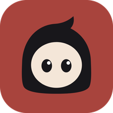

# Super Agents



Your team's AI agents, on one page. Super Agents turns every teammate's Claude Code and Codex sessions into live progress per task, and **Agent S**, running on NVIDIA Nemotron, answers questions about the team's work with the session events behind every answer. Nobody types a status update.

> **Status: building, invite only.** Started 13 Oct 2026 for the Nebius × NVIDIA Global AI Hackathon. **Website and waitlist: https://teamloop.vercel.app**; invited people download the app from their invite link. Open source, MIT.

## How it works
1. Each developer installs the Super Agents app and signs in with GitHub. The app connects their repos: Claude Code and Codex hooks call the connector after every turn and tool call.
2. The connector writes each event to a local spool. Secrets are hidden first, and file paths are made repo-relative.
3. Free text, like the agent's last message, never reaches the team. It's read once, to write a one-line summary: by Nemotron through the hub, which keeps none of it (or by a local model with `TEAMLOOP_SUMMARIZER=ollama`).
4. Summaries and structured facts (files changed, tests passed or failed, commits, token counts) go to the team hub. Agent S, on NVIDIA Nemotron via Nebius Token Factory, turns them into per-task progress and answers questions with citations.

## NVIDIA Nemotron on Nebius Token Factory
Every model call in Super Agents is NVIDIA Nemotron on Nebius Token Factory, through its OpenAI-compatible API with one key, held by the hub. Three sizes, routed by job (`agent_s/agent_s/llm.py`):

| Job | Model | Why this one |
|---|---|---|
| A one-line summary of every coding turn | Nemotron 3.5 Lightning, thinking off | One line from one message: one call, about a second, ~40 tokens |
| Each step of an agent in the app (Auto) | Nemotron 3 Super (120B, 12B active) | Reliable tool calling for the agent loop; people can pin Lightning, Super or Ultra and set how hard it thinks (`reasoning_effort`, low to max) |
| Progress per task, and Ask | Nemotron 3 Super | Strict JSON-schema answers in which every claim cites an event; uncited items are dropped in code |
| The daily digest | Nemotron 3 Ultra (550B, 55B active) | The one job that reasons across a whole day of every task |

A timeout, 429 or 5xx is retried once, and an Ultra job then falls back to Super.

What Token Factory made easy: one endpoint for three sizes, so routing is a per-call model name, not separate deployments; strict JSON-schema output, which keeps citations machine-checkable; and OpenAI-style tool calling, so the agent loop runs on each laptop while every step goes through the hub's key.

Measured on Token Factory (October 2026):
- **Agent S eval** (`python scripts/eval_agent_s.py` over `agent_s/golden/`): on Super, 4/4 progress estimates in range, 0 uncited claims, and 5/5 good answers, including "I don't have evidence for that" when the record doesn't show it; about 2 s a call ([docs/research/eval-20261013-nebius.md](docs/research/eval-20261013-nebius.md)).
- **Tokens:** tool definitions were about 5,400 of the 7,000 input tokens of every agent step, so a step now sends the big tool groups only when the answer needs them: a simple step went from 7,014 to 3,629 tokens. Turn summaries without thinking take one call and ~40 tokens, where Lightning thinking first took three calls and ~1,400.

**Never shared with the team from coding sessions:** prompts, the agent's replies, tool output, file contents, diffs, keystrokes, screenshots. No rankings, no time tracking. The exceptions are explicit: a prompt you allow into your session, and files you share with a teammate in Super Team → Files.

## In the app
- **Super Team.** Anyone on the team can prompt a teammate's live Claude Code or Codex session (the agent that has the context), by that owner's rules: off, ask each time, or automatic; read only or edit; a daily token limit per teammate. It runs on the owner's laptop as a copy of the session, and every prompt is on record: who asked what, who allowed it, what it used. Threads are saved, so a follow-up sent while the owner's laptop is closed waits and runs, as a follow-up, when it's back. Teammates also share files (saved into the recipient's project, out of git) and hand over branches, on the record.
- **Lead tools.** Agent S plans with deadlines, assigns work, and reviews code (a branch's diff, a GitHub pull request, or the author's own session), in Manual, Plan or Auto mode.
- **Git, like Claude Code.** Agents branch, commit, push and open pull requests with your own GitHub sign-in; commits name their files and never land on the default branch, and every push asks first. **Get the project** clones the team's GitHub repos into a folder you pick and connects them.
- **Team usage.** A counter for the team's AI: tokens per task, per day, per tool (Claude Code, Codex, Super Agents) and per person, counted on each laptop from the agents' own logs. Leads see everyone; members see themselves.
- **Agents with their own behaviour.** Agent S is built in; add a reviewer, a release manager, anyone: each with its own instructions, default Nemotron model and mode, skills, MCP connectors and tools.
- **Memory.** Agents keep notes (yours or theirs) and recall what happened before: earlier chats and your own Claude Code and Codex sessions in every project on the laptop, through a local full-text index that never leaves it.
- **Manual, Plan and Auto modes**, as in Claude Code (Shift+Tab). Manual asks before every change, Plan queues changes until you run the plan, Auto runs them with Undo. Shell commands always ask.
- **Skills** in Claude Code's format, including importing your own. **Karpathy's coding guidelines** are on by default for every agent.
- **Connectors**: any MCP server, by URL or command, with presets for GitHub, Context7, Filesystem and Memory.
- **Desktop control on Windows**, when you turn it on: agents use your apps through their own controls (no mouse, no keyboard, no taking over your screen) to fill in a form, save a file or read a value. Each app asks first; settings, security and password apps are never touched; Ctrl+Alt+Esc stops it.
- **Your agents from your phone**, like Claude Code's Remote Control. It comes as a native Android app (APK) or a web app for the home screen; you pair it with a QR code. Everything waiting for your yes, from every running turn, sits in one Needs you list: swipe right to approve, left to deny. On Android a question also arrives as a notification you can answer from, while the app is in the background. It also has your chats, the team's board, and a fingerprint lock, while the agents keep running on the laptop. It's end-to-end encrypted: the key travels only in the QR code, so the relay sees nothing.
- **A browser you share with your agents.** They start your dev server, open it, click through it, read the console and check their own fixes while you watch in the side panel, and you can take over. Next to it: a file viewer for your connected repos and real terminals.

Chats with your agents leave the laptop by design (besides the turn messages that get summarized): to answer, a message and what its tools read (including what `recall` finds in your own past sessions) go to Nemotron through the Super Agents server, which doesn't store them. Details: [docs/app.md](docs/app.md).

## Install on Windows
1. Open your invite link and download `SuperAgents-Setup.exe` there (or from [Releases](https://github.com/JrKrishh/teamloop-team/releases/latest)), then open it. Until the app is code-signed, Windows may say it "protected your PC": choose **More info → Run anyway**.
2. It installs for your Windows user (no admin), adds the `teamloop` command to your PATH, makes Start-menu and desktop shortcuts, and opens the app. Opening it again brings the same window forward. Uninstall it from Settings → Apps; your data in `~/.teamloop` stays.
3. Continue with GitHub, then create your team or join with your lead's invite link. Pick the repos to connect on **This laptop**.

**On your phone:** download `SuperAgents-android.apk` from [Releases](https://github.com/JrKrishh/teamloop-team/releases/latest) and open it (Android asks once to allow installs from your browser); iPhones use the web app at https://teamloop.vercel.app/remote/. Then pair in the app's Settings → Phone. Building the APK: [android/README.md](android/README.md).

How the app works, including sign-in and the local server's security: [docs/app.md](docs/app.md). The accounts and the hub: [docs/cloud.md](docs/cloud.md).

**Self-hosted instead**, for the connector and a web board only (the desktop app and the phone need the hosted hub's accounts): `teamloop hub` runs the board on your machine with a room token and lead key (data in `~/.teamloop/hub/`), and prints the invite teammates pass to `teamloop login <invite>`. For teammates elsewhere, run `cloudflared tunnel --url http://localhost:8799`, then `teamloop hub --public-url <that URL>`. Hosting one: [docs/deploy.md](docs/deploy.md).

The same install is the hook handler and the MCP server (`teamloop.exe`), so connecting a repo points Claude Code and Codex at it. **Hooks cost about 0.4 s per tool call** with the exe (Python startup), against about 0.17 s when installed with pip.

## Connector
```bash
cd connector && uv venv && uv pip install -e ".[dev]"
cd /path/to/your/repo
teamloop init                     # Claude Code (+ Codex if installed): hooks, MCP server, commit-trailer hook
teamloop task T-14 "Add SSE"      # what this repo is working on
teamloop doctor                   # every check, with the command that fixes it
teamloop pause                    # record nothing until `teamloop resume`
```
`init` writes hooks to `.claude/settings.local.json` (personal, kept out of git), so teammates without TeamLoop are never affected. Use `--scope user` to cover every repo, and `--dry-run` to preview.

Codex asks you once to trust the repo's hooks (`codex`, then `/hooks`).

Your agent gets four MCP tools: `task_start`, `report_progress`, `mark_blocked` and `get_team_status` (what teammates are doing). Commits get a `TeamLoop-Task:` trailer, even with `--no-verify`.

## Self-hosted hub
```bash
uv pip install -e agent_s -e connector -e "hub[dev]"
CCBRIDGE_ROOMS="teamloop:<room token>" CCBRIDGE_OPEN_ROOMS=0 HUB_SECURE_COOKIE=0   uvicorn hub.app:app_from_env --factory --port 8799        # HUB_SECURE_COOKIE=0 only for plain http on localhost
teamloop invite --url http://<hub>:8799 --room teamloop --token <room token>   # share this with the team
teamloop login <invite> --name yang                                            # each teammate, once
```
Open `http://<hub>:8799/`, sign in with the room and token, and watch tasks fill in.

**Agent S's model:** set `NEBIUS_API_KEY` for NVIDIA Nemotron on Token Factory. Otherwise it uses a local Ollama model (`AGENT_S_PROVIDER=ollama`).

**GitHub:** see [docs/github-setup.md](docs/github-setup.md).

## Where things live
| Folder | What | Runs |
|---|---|---|
| `app/` | The Super Agents desktop app: window and local server (`server.py`), the agent loop and its tools (`runtime/`), the UI (`ui/`), the phone link (`remote.py`), Super Team's runner (`superteam.py`) | Each laptop, as `SuperAgents.exe` |
| `connector/` | `teamloop`: the coding agents' hooks, redaction, the spool and sender, the MCP server, the CLI | Each laptop, as `teamloop.exe` |
| `cloud/` | The hosted hub: accounts, teams, events, the board, Agent S, Super Team, files, usage; the website (`cloud/site`) and the phone web app (`cloud/site/remote`) | Vercel and Supabase |
| `hub/` | The self-hosted hub, and what both hubs share: cards, usage sums, event checks, prompt-injection safety, the web board page | Your machine, or inside `cloud/` |
| `agent_s/` | Agent S: progress from events, answers with citations, the digest, model routing (Nemotron on Nebius; Ollama in development) | Inside the hubs |
| `android/` | The phone app (Kotlin, Compose) | Android |
| `packaging/` | The PyInstaller build, the Inno Setup installer and its check | CI |
| `api/`, `vercel.json` | The Vercel entry point | Vercel |

Docs: the app [docs/app.md](docs/app.md), the hosted hub [docs/cloud.md](docs/cloud.md), the event API [docs/hub-api.md](docs/hub-api.md), releasing [docs/release.md](docs/release.md), trying it as a judge [docs/judging.md](docs/judging.md). [PLAN.md](PLAN.md) is the plan of 13 Oct, kept for its reasoning.

## Tests
```bash
cd connector && python -m pytest -q    # the same in app, hub, agent_s and cloud (cloud starts its own Postgres with pgserver)
cd android && ./gradlew testDebugUnitTest
```

## Credits
- [ccbridge](https://github.com/sourabhnirvani/ccbridge) (MIT, by Sourabh, @sourabhnirvani): relay, rooms, invites and prompt-injection safety. The hub builds on it.
- TeamLoop neatHack (MIT): Agent S, the Hoodie design and colours, the mascot art (`hub/hub/static/mascot`), and secret redaction.
- Fonts: Bricolage Grotesque, Figtree, JetBrains Mono (SIL Open Font License), bundled in the app.
- [andrej-karpathy-skills](https://github.com/multica-ai/andrej-karpathy-skills) by forrestchang (MIT): the bundled `karpathy-guidelines` skill.
- xterm.js (MIT), highlight.js (BSD-3-Clause), marked (MIT) and DOMPurify (Apache-2.0 / MPL-2.0), vendored in `app/superagents/ui/vendor/`.

MIT licensed.
